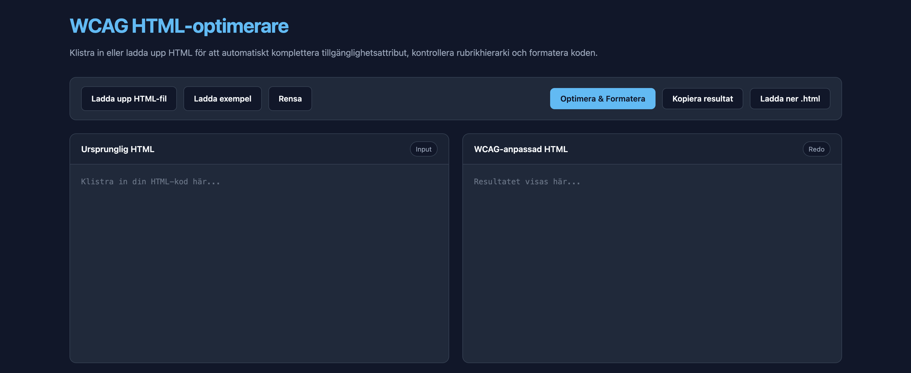
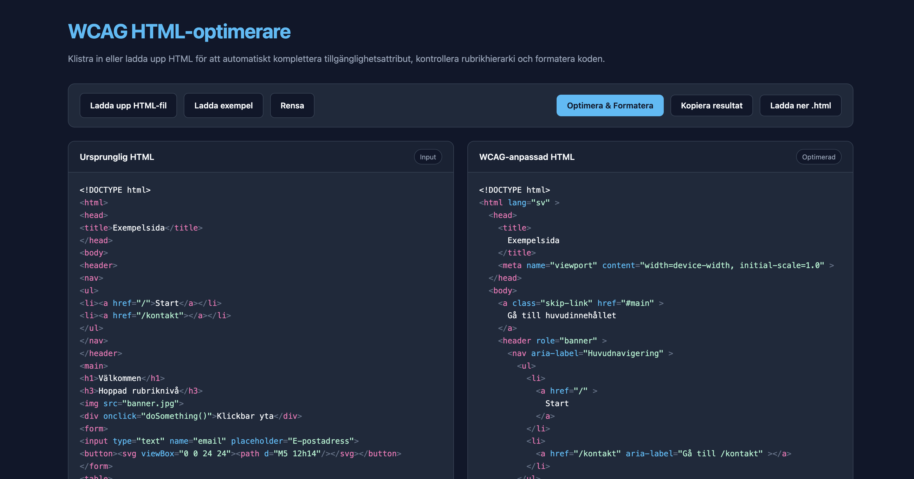
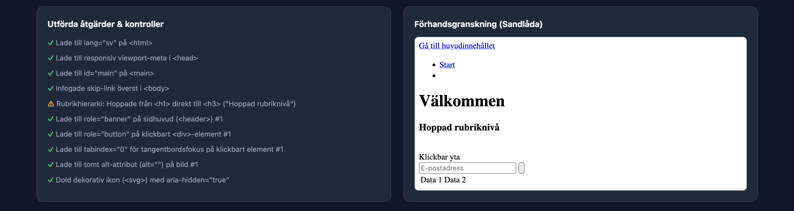

# HTML WCAG Fixer
En modern, fristående och säker webbapplikation som automatiskt analyserar, korrigerar och formaterar HTML-kod enligt **WCAG** (Web Content Accessibility Guidelines). Verktyget är byggt helt utan externa ramverk eller tredjepartsbibliotek och körs direkt i webbläsaren.







---

## Funktioner

### Automatiska WCAG-korrigeringar
Applikationen tolkar inmatad HTML-kod via webbläsarens inbyggda `DOMParser` och kompletterar saknade tillgänglighetsattribut:

* **Dokumentstruktur & Språk:** Lägger till `lang="sv"` på `<html>` samt en responsiv `<meta name="viewport">`-tagg om de saknas.
* **Hoppa till innehåll (Skip-link):** Lägger automatiskt till `id="main"` på `<main>` och infogar `<a class="skip-link" href="#main">Gå till huvudinnehållet</a>` överst i `<body>`.
* **Landmärken & Roller (`role`):** Kompletterar med `role="banner"` på sidhuvud (`<header>`), `role="contentinfo"` på sidfot (`<footer>`), `role="complementary"` på `<aside>` samt `role="button"` och `tabindex="0"` på klickbara element (`onclick`) som saknar semantisk tagg.
* **Rubrikhierarki (`h1`–`h6`):** Kontrollerar att dokumentet har exakt en `<h1>` och varnar om rubriknivåer hoppas över (t.ex. från `<h1>` direkt till `<h3>`).
* **Bilder & Dekorativa ikoner:** Lägger till tomt alt-attribut (`alt=""`) på ``-element som saknar `alt`, samt döljer dekorativa ikoner (`<svg>` och ikon-taggar utan titel/etikett) med `aria-hidden="true"`.
* **Knappar & Länkar:** Sätter `type="button"` på knappar utan typ, genererar beskrivande `aria-label` för tomma knappar och länkar, samt säkrar externa länkar (`target="_blank"`) med `rel="noopener noreferrer"`.
* **Formulär, Navigering & Tabeller:** Lägger till `aria-label` på formulärfält som saknar kopplad `<label>`, samt på `<nav>` och `<table>` som saknar etikett eller `<caption>`.

### Smarta redigeringsverktyg
* **Realtidsuppdatering:** Resultatet, ändringsloggen och förhandsgranskningen uppdateras automatiskt medan du skriver eller klistrar in kod.
* **Inbyggd Syntax Highlighting:** Färglägger HTML-taggar, attribut, värden och kommentarer i realtid med ren CSS och JavaScript – helt utan externa bibliotek som Prism.js.
* **Kodformatering:** Indenterar HTML-strukturen och lägger till rena mellanslag kring infogade attribut för maximal läsbarhet.
* **Isolerad förhandsgranskning (Sandlåda):** Visar hur den optimerade HTML-koden renderas i en säker `<iframe>` med `sandbox`-attribut.
* **Filhantering:** Ladda upp befintliga `.html`-, `.htm`- eller `.txt`-filer, kopiera resultatet till urklipp eller ladda ner den färdiga filen som `wcag-optimerad.html`.

## Kodexempel: Före & Efter

### Före (Ursprunglig HTML)
```html
<!DOCTYPE html>
<html>
<head>
<title>Exempelsida</title>
</head>
<body>
<header>
<nav>
<ul>
<li><a href="/">Start</a></li>
<li><a href="/kontakt"></a></li>
</ul>
</nav>
</header>
<main>
<h1>Välkommen</h1>

<div onclick="doSomething()">Klickbar yta</div>
<form>
<input type="text" name="email" placeholder="E-postadress">
<button><svg viewBox="0 0 24 24"><path d="M5 12h14"/></svg></button>
</form>
</main>
</body>
</html>
```

### Efter (WCAG-anpassad HTML)
```html
<!DOCTYPE html>
<html lang="sv" >
  <head>
    <title>Exempelsida</title>
    <meta name="viewport" content="width=device-width, initial-scale=1.0" >
  </head>
  <body>
    <a class="skip-link" href="#main" >Gå till huvudinnehållet</a>
    <header role="banner" >
      <nav aria-label="Huvudnavigering" >
        <ul>
          <li>
            <a href="/" >Start</a>
          </li>
          <li>
            <a href="/kontakt" aria-label="Gå till /kontakt" ></a>
          </li>
        </ul>
      </nav>
    </header>
    <main id="main" >
      <h1>Välkommen</h1>
      
      <div onclick="doSomething()" role="button" tabindex="0" >Klickbar yta</div>
      <form>
        <input type="text" name="email" placeholder="E-postadress" aria-label="E-postadress" >
        <button type="button" aria-label="Åtgärdsknapp 1" >
          <svg viewBox="0 0 24 24" aria-hidden="true" >
            <path d="M5 12h14" ></path>
          </svg>
        </button>
      </form>
    </main>
  </body>
</html>
```

## Teknikstack

Projektet består av en enda fristående HTML-fil (`index.html`) och kräver ingen byggprocess eller pakethanterare:

* **HTML5:** Semantisk struktur och isolerad sandlåda (`iframe[sandbox]`).
* **Modern CSS:** CSS Custom Properties (variabler), CSS Grid/Flexbox och inbyggd CSS-nästling (`&`).
* **JavaScript (ES6+):** `DOMParser`, `FileReader`, `Blob` API, Clipboard API och debounce-hantering.

## Kom igång

1. Öppna `index.html` direkt i valfri modern webbläsare (Chrome, Firefox, Edge eller Safari).

*Ingen installation, server eller internetuppkoppling krävs.*

## Användning

1. **Klistra in kod** i rutan *Ursprunglig HTML*, klicka på **Ladda upp HTML-fil** eller testa med knappen **Ladda exempel**.
2. Koden analyseras och formateras automatiskt i rutan *WCAG-anpassad HTML*.
3. Granska listan under **Utförda åtgärder & kontroller** för att se exakt vilka attribut som lagts till samt eventuella varningar kring rubrikhierarki.
4. Kontrollera resultatet visuellt i **Förhandsgranskning (Sandlåda)**.
5. Klicka på **Kopiera resultat** eller **Ladda ner .html** för att använda din uppdaterade kod.

## Säkerhet & Integritet

All kodanalys sker 100 % lokalt i din webbläsare. Ingen HTML-kod skickas till någon extern server. Uppladdad och inklistrad kod parsas säkert via `DOMParser` utan att exekvera eventuella `<script>`-taggar, och förhandsgranskningen körs i en begränsad `sandbox`-miljö.
